> **Copia para Antigravity.** El original está en `2-Documento-Investigacion/` (documento de investigación + matriz de conceptos de todas las clases del año aplicados a Serrano Trabaja). Si cambia el original, volver a copiarlo acá.
> Según la indicación del profesor, este es el documento que Antigravity tiene que analizar para armar los documentos de contexto (`docs/contexto/`).

# Serrano Trabaja — Documento de investigación

**EFI · Interfaz de Usuario 2026**
**Equipo:** Tiago Pescara y Valentín Belone

> Las partes marcadas con **[COMPLETAR]** son datos que solo puede poner el equipo.

---

## 1. Resumen de la idea

En Serrano, un pueblo chico de Córdoba, las changas y los trabajos circulan de boca en boca o por grupos de WhatsApp desordenados. Quien necesita un plomero, un changarín o alguien para limpiar no tiene un lugar donde buscar; y quien sabe hacer algo no tiene cómo mostrarse, así que queda invisible.

**Serrano Trabaja** es una app que junta las dos puntas en un solo lugar:

- **Quien busca a alguien** encuentra trabajadores del pueblo por oficio y por zona, y ve sus estrellas, las opiniones de otros vecinos y quiénes lo recomiendan antes de contactarlo. También puede **pedir una changa** en menos de un minuto.
- **Quien busca changas** se muestra con su oficio, marca si está **"Disponible hoy"** y recibe un aviso cuando alguien pide un trabajo de lo suyo.
- Los dos arreglan día y precio por mensaje, acuerdan una **seña o pago** (en efectivo, por transferencia o con Mercado Pago) y, al terminar, quien contrató **deja su opinión**, que se suma al perfil del trabajador.

Hay un solo perfil por persona: la misma cuenta sirve para contratar y para ofrecerse, porque en un pueblo muchas personas hacen las dos cosas.

## 2. Datos de la empresa

| | |
|---|---|
| **Nombre** | Serrano Trabaja |
| **Rubro** | Plataforma local de changas, oficios y servicios |
| **Alcance** | Serrano (Córdoba), con posibilidad de replicarse en pueblos vecinos |
| **Propuesta en una frase** | "Encontrá a alguien de confianza del pueblo, o conseguí trabajo cerca de tu casa." |

### Ícono para apps y tiendas

Pin de ubicación con un check, sobre azul. El pin habla de *lo cercano, del pueblo*; el check, de *confirmado y de confianza*. El azul `#1D6FE0` transmite seguridad (Clase 5) y con el blanco da un contraste de 4.77:1.

Archivos en [`Marca/`](../../../../2-Documento-Investigacion/Marca/): `icono-app.svg` (vectorial), `icono-app-1024.png` (App Store / Play Store), `icono-app-512.png`, `icono-app-192.png` (web/Android) y `favicon.svg`.

### Logo en sus formatos

| Formato | Uso | Archivo |
|---|---|---|
| Horizontal | Encabezados, web, documentos |  `logo-horizontal.svg / .png` |
| Vertical | Redes sociales, cartelería, afiches | `logo-vertical.svg / .png` |
| Negativo | Sobre fondo azul o fotos oscuras | `logo-horizontal-negativo.svg / .png` |
| Monocromo | Impresión en blanco y negro, sellos, fotocopias | `logo-monocromo.svg / .png` |

Tipografía de la marca: **Inter** (Bold para "Serrano", Semibold para "Trabaja").

## 3. Valor agregado

¿Qué tiene Serrano Trabaja que no se encuentra en las opciones gratuitas (grupos de WhatsApp, Facebook, clasificados)?

| Hoy (gratis) | Serrano Trabaja |
|---|---|
| Los pedidos se pierden entre cientos de mensajes del grupo | Búsqueda por **oficio** y por **zona del pueblo**; los pedidos no se pierden |
| No hay forma de saber si alguien es confiable: "¿conocés a alguien que…?" | **Estrellas, opiniones de vecinos, teléfono confirmado** y **vecinos que lo recomiendan**, a la vista antes de contactar |
| El trabajador depende de que alguien se acuerde de él | Perfil propio, botón **"Disponible hoy"** y **avisos** de changas nuevas de su oficio |
| Nada queda registrado: ni el precio ni lo acordado | **Acuerdo de seña o pago** anotado en la app (efectivo sin comisión, o Mercado Pago) e **historial** de trabajos |
| Las apps grandes no están pensadas para un adulto mayor ni para poca señal | Diseñada para el **usuario límite**: letra grande, botones grandes, lenguaje simple y **funciona con señal débil** |
| Si algo sale mal, no hay a quién avisar | **"Avisar de un problema"** desde cada ficha, revisado por una persona |

### Modelo de ingresos

- **Comisión chica** solo en pagos con Mercado Pago (el efectivo es gratis).
- **Aparecer primero** ($1.500/mes): el trabajador sale arriba en la búsqueda con la marca "Destacado".
- **Trabajadores sugeridos** ($2.500/mes): para comercios y campos que contratan seguido.
- **Cursos para aprender un oficio:** inscripción a cursos de instituciones del pueblo (algunos gratis).

## 4. Cómo ayuda a la comunidad

- **Hace visible a quien trabaja:** el changarín o la señora que limpia por horas pasan a tener un perfil con su historial y lo que dicen los vecinos, algo que antes solo vivía en la memoria del pueblo.
- **Más confianza para contratar:** en un pueblo "no le abrís la puerta a cualquiera". La reputación vecinal pasa de ser un rumor a ser información a la vista.
- **La plata queda en el pueblo:** facilita que los trabajos se resuelvan con gente de Serrano y no con empresas de afuera.
- **Inclusión digital:** al estar pensada para adultos mayores y celulares viejos, incorpora a gente que hoy queda afuera de las apps.
- **Aprender un oficio:** los cursos de la Escuela Técnica y del Centro de Jubilados le dan más herramientas a quien busca trabajo.
- **Primer paso hacia la formalización:** el historial y las opiniones funcionan como un "certificado de trabajo" informal.

## 5. Cómo lo diseñamos (proceso DCU)

Seguimos el bucle de Diseño Centrado en el Usuario de la Clase 6: **entender → definir requisitos → diseñar → evaluar → iterar**.

| Etapa | Qué hicimos | Evidencia |
|---|---|---|
| Entender el contexto | Actores, contexto previo (boca en boca, WhatsApp), dispositivos y conectividad de Serrano. Definimos al **usuario límite**. | [TP Usabilidad y A11y](../../../../2-Documento-Investigacion/Anexos/Reto1-2_Usabilidad_A11y/) |
| Requisitos | Hit targets grandes, nada solo por color, lenguaje literal, ingreso por SMS sin cámara, tolerancia a señal débil. | TP Usabilidad y A11y |
| Primeros bocetos | Selección de rol, perfil del trabajador y aviso de error (mobile y desktop). | [Bocetos](../../../../2-Documento-Investigacion/Anexos/Reto1-2_Usabilidad_A11y/bocetos/) |
| Organizar el contenido | **Card Sorting abierto** con 5 vecinos (21 al 26/09/2026): 24 tarjetas agrupadas en 6 categorías, con matriz de acuerdo. | [Card Sorting + Sitemap](../../../../2-Documento-Investigacion/Anexos/Reto6_Card_Sorting/) |
| Flujo | User Flow con el camino principal y los caminos de error. | [User Flow](../../../../2-Documento-Investigacion/Anexos/User_Flow/Serrano_Trabaja_UserFlow.png) |
| Sistema visual | **UI Kit:** paleta con contraste verificado, escala tipográfica y componentes con sus estados. | [UI Kit](../../../../2-Documento-Investigacion/Anexos/Reto5_UI_Kit/Reto5_UI_Kit_Serrano_Trabaja.md) |
| Wireframes y prototipo | Wireframe low-fi navegable en Figma (21 pantallas, flujo completo) y Web SPA con las 4 pantallas centrales. | [Reto 7](../../../../2-Documento-Investigacion/Anexos/Reto7_Wireframes_Figma/) · [Prototipo](../../../../1-Prototipo-WebSPA/) |
| **Iterar** | Con el Card Sorting cambiamos la navegación (5 secciones), 8 etiquetas, el ingreso (un solo perfil) y corregimos colores que no llegaban a 4.5:1. | Este documento |

### Lo que cambió gracias a los usuarios

| Antes | Después | Por qué |
|---|---|---|
| "Soy Empleador / Soy Trabajador" | "¿Buscás a alguien o buscás changas?" (un solo perfil) | Varios participantes cumplen los dos roles; una empleadora preguntó si ella también tenía perfil |
| "Publicar una changa" | "Pedir una changa" | Los trabajadores entendían "publicarme yo" |
| "Denunciar perfil" | "Avisar de un problema" | "¿Denunciar a quién? ¿Esto va a la comisaría?" |
| "Reputación" | "Mis estrellas" | "¿Reputación y reseñas no es lo mismo?" |
| "Suscripción / destacado" | "Destacados" y "Aparecer primero" | La palabra "suscripción" tapaba la función |
| Feed único de publicaciones | Buscar trabajadores + filtros por oficio y zona | El grupo "Buscar" tuvo acuerdo 5/5 |

## 6. Conceptos del cursado y cómo se implementaron

El detalle completo, concepto por concepto y con la pantalla donde se ve cada uno, está en **[EFI_Matriz_conceptos_Serrano_Trabaja.md](../../../../2-Documento-Investigacion/EFI_Matriz_conceptos_Serrano_Trabaja.md)**. Resumen:

- **Clase 1 — UX/UI y pilares:** la UX es reemplazar el boca en boca por confianza visible; los pilares guían cada decisión.
- **Clase 2 — Usabilidad y A11y (WCAG):** 56px mínimos, contraste 4.5:1, estados con ícono + forma + texto, errores que no borran datos.
- **Clase 3 — Affordance y modelos mentales:** botones con relieve que se hunden, cards tocables vs. planas, etiquetas tomadas de las palabras de los usuarios.
- **Clase 4 — Gestalt y jerarquía:** cards agrupadas por proximidad, una sola acción principal por pantalla, patrón Z, continuidad en los pasos del trabajo.
- **Clase 5 — Color, tipografía y componentes:** UI Kit con paleta semántica, escala 32/24/18/14 y los 5 estados del botón.
- **Clase 6 — DCU y Personas:** proceso iterativo; los 5 participantes del Card Sorting como perfiles reales.
- **Clase 7 — Arquitectura de información:** Card Sorting abierto, sitemap de 5 secciones, rotulado en lenguaje cotidiano, búsqueda con filtros.
- **Clase 8 y Clase 8 ++ — Prototipado y Figma avanzado:** wireframe low-fi navegable en Figma, componentes con variantes, auto-layout, posición fija y Web SPA.
- **Clase 9 — Sistemas de diseño y microinteracciones:** el UI Kit funciona como sistema de diseño (tokens, tipografía, componentes y reglas); la interfaz se puede leer en diseño atómico (botón y chip → card de trabajador → catálogo); botones que se hunden, chips con check y "Disponible hoy / Ocupado" como microinteracciones.
- **Clase 10 — Accesibilidad aplicada y UX Writing:** cumplimos de sobra los mínimos de la clase (56px en vez de 44px, 18px en vez de 16px); textos funcionales con verbos concretos, estados vacíos que dicen qué hacer, confirmaciones y errores en lenguaje del vecino.

### Capturas

Capturas de la Web SPA (celular de 390px y escritorio de 1280px) y del wireframe de Figma. Todas las capturas de la SPA están en [`Capturas/`](../../../../2-Documento-Investigacion/Capturas/).

**Confianza antes de contactar (Clase 1 · Emoción), proximidad y jerarquía (Clase 4), affordance e íconos con etiqueta (Clases 3 y 10)**

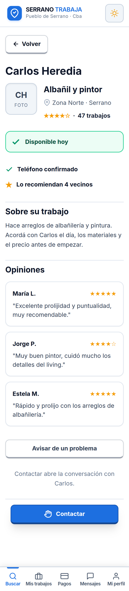 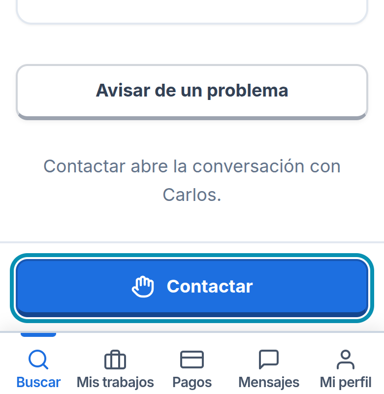

Ficha del trabajador: estrellas, "Teléfono confirmado" y "Lo recomiendan 4 vecinos" antes de Contactar. A la derecha, el anillo celeste de foco al navegar con teclado (WCAG: Operable).

**Búsqueda y filtros (Clase 7), diseño atómico (Clase 9), estado vacío (Clase 10)**

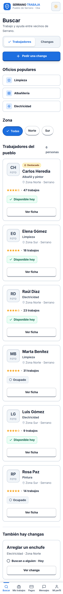 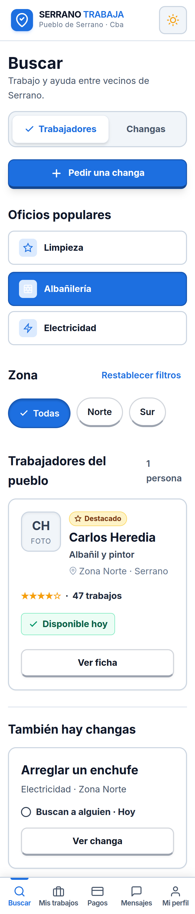 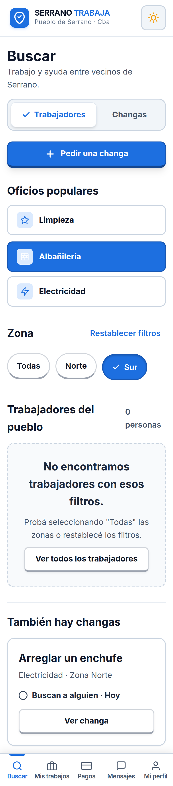

Buscar: chips de oficio y zona; la card de trabajador es una molécula que se repite en el catálogo (organismo). Con filtros sin resultados, la pantalla explica qué hacer y ofrece "Ver todos los trabajadores".

**Esfuerzo–beneficio (Clase 2), 5 estados del botón (Clase 5), microinteracción que guía (Clase 9), UX Writing y errores (Clase 10)**

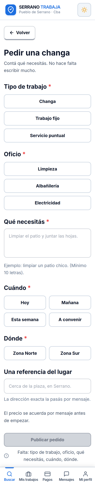 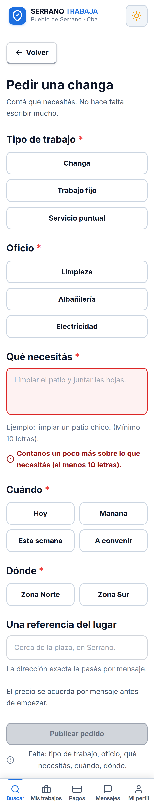 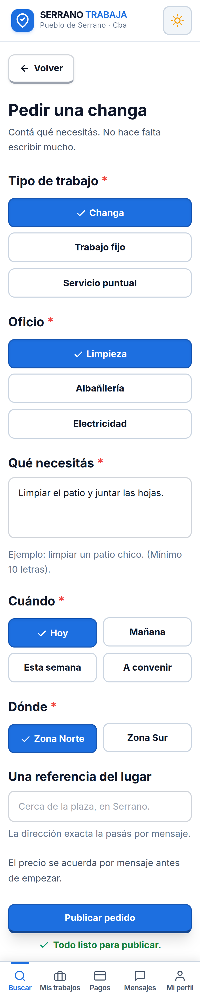

Pedir una changa: arranca sin nada elegido y el botón dice "Falta: …"; el error tiene borde + ícono + texto y no borra lo escrito; al completar, "Todo listo para publicar."

**Confirmaciones (Clase 10), feedback inmediato (Clase 3)**

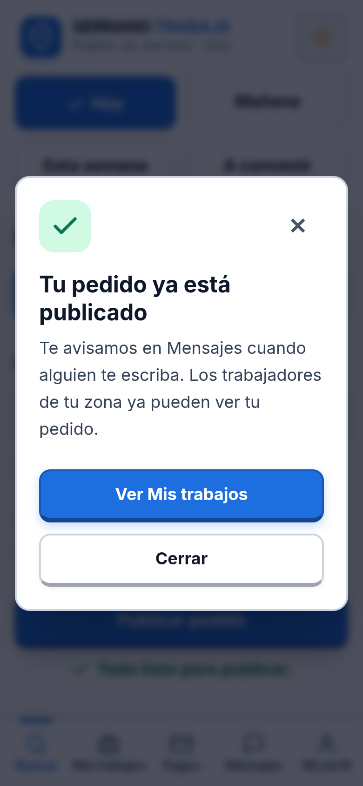 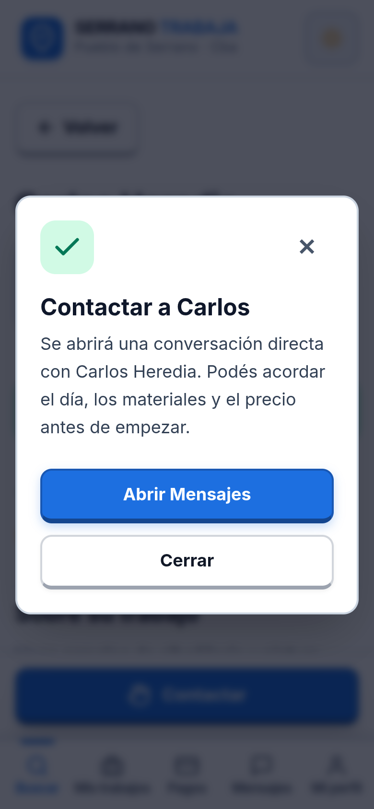

Ventanas de confirmación con botones que dicen lo que hacen ("Ver Mis trabajos", "Abrir Mensajes") en vez de "OK".

**Pilar de desempeño: funciona con señal débil (Clases 1 y 2)**

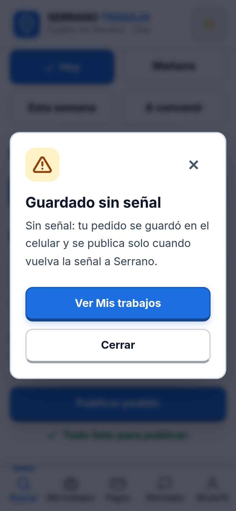 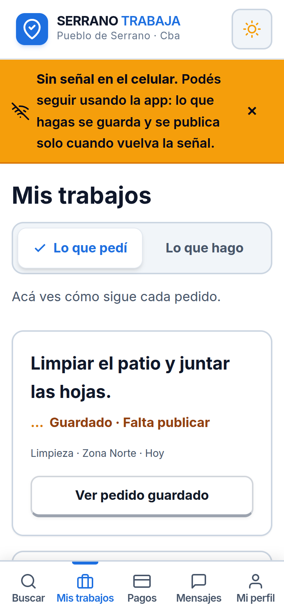 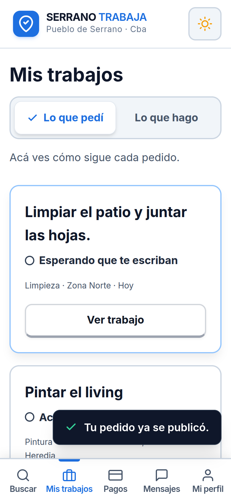

Sin señal, el pedido se guarda en el celular ("Guardado · Falta publicar"); cuando vuelve la señal se publica solo y avisa "Tu pedido ya se publicó."

**Sistema de organización (Clase 7), estados sin depender del color (Clase 2)**

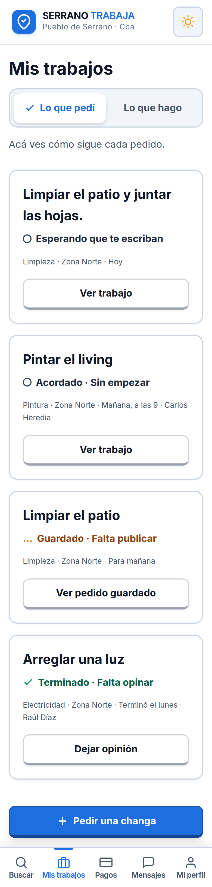 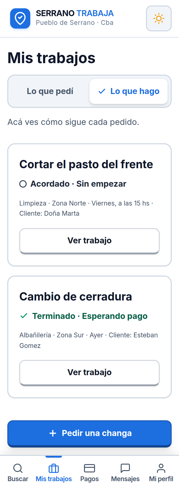

Mis trabajos: "Lo que pedí" y "Lo que hago"; cada estado tiene ícono y texto (círculo, check, "…"), no solo color.

**No solo color (Clases 2 y 10)**

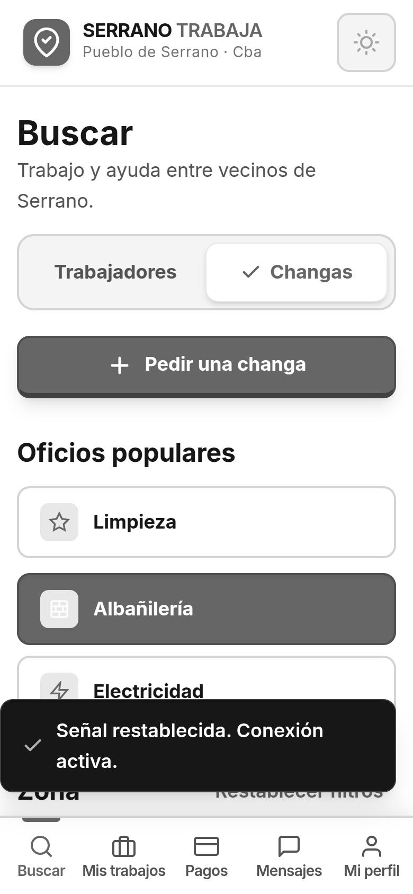

La misma pantalla en escala de grises: la opción elegida, la disponibilidad y los botones se siguen entendiendo.

**Responsive, tokens de diseño y modo oscuro (Clases 8 ++ y 9)**

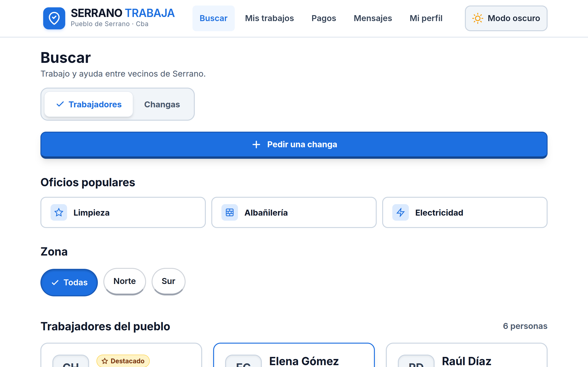 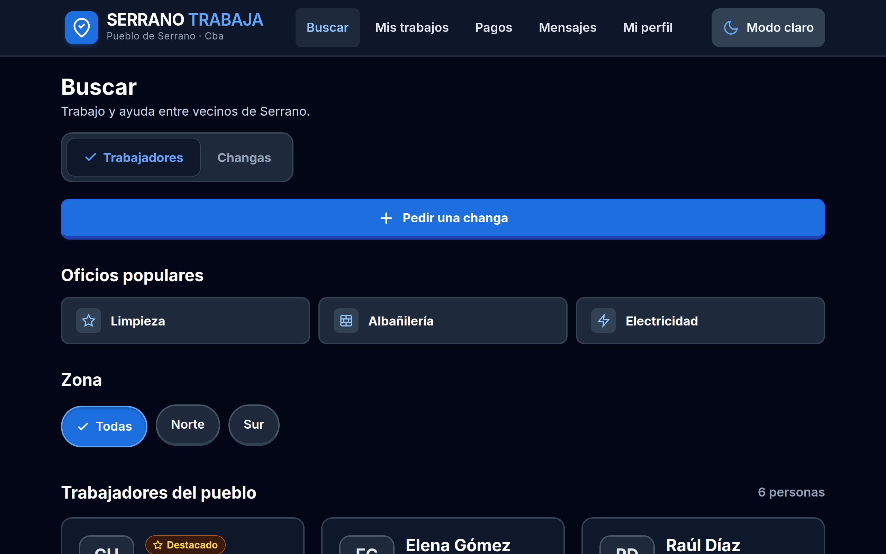

Escritorio: barra de navegación arriba y catálogo en 3 columnas. El modo oscuro cambia los valores de los tokens de color, no cada pantalla.

**Wireframe low-fi navegable (Clase 8), onboarding y patrones avanzados (Clase 10)**

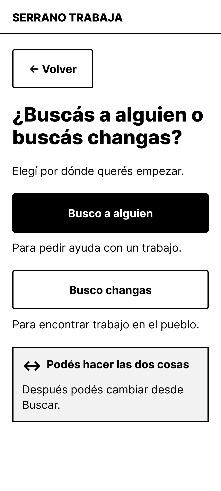 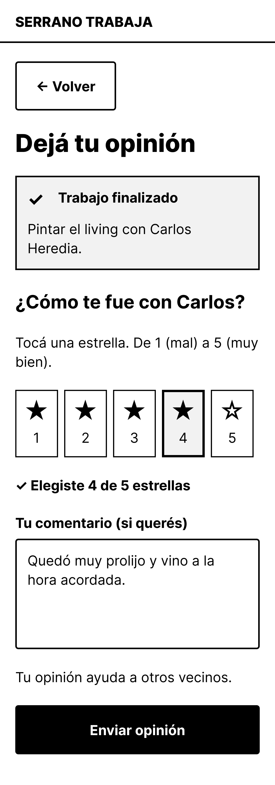 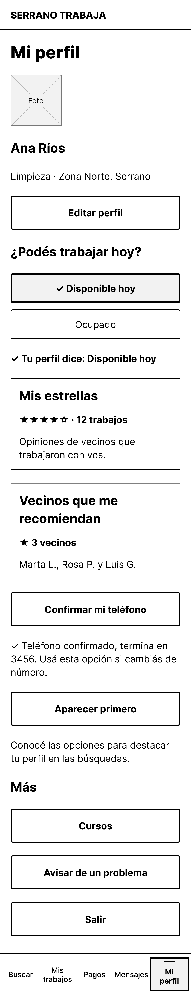

Pantallas del wireframe de Figma que completan el flujo: la pregunta inicial "¿Buscás a alguien o buscás changas?", la opinión con estrellas grandes y "Disponible hoy / Ocupado" en Mi perfil.

## 7. Equipo

| Foto | Nombre | Cargo | Sobre mí |
|---|---|---|---|
| **[COMPLETAR: foto]** | **Tiago Pescara** | **[COMPLETAR: ej. Investigación UX y Arquitectura de información]** | **[COMPLETAR: 2 o 3 líneas: quién es, qué hizo en el proyecto, qué le interesa]** |
| **[COMPLETAR: foto]** | **Valentín Belone** | **[COMPLETAR: ej. Diseño UI y Desarrollo del prototipo]** | **[COMPLETAR]** |

## 8. Anexos

| Anexo | Contenido |
|---|---|
| [Reto1-2_Usabilidad_A11y/](../../../../2-Documento-Investigacion/Anexos/Reto1-2_Usabilidad_A11y/) | TP de Usabilidad y A11y + bocetos mobile/desktop |
| [Reto5_UI_Kit/](../../../../2-Documento-Investigacion/Anexos/Reto5_UI_Kit/) | UI Kit: paleta, tipografía, componentes y reglas (se ve aplicado en la Web SPA) |
| [Reto6_Card_Sorting/](../../../../2-Documento-Investigacion/Anexos/Reto6_Card_Sorting/) | Sesiones, análisis y sitemap |
| [Reto7_Wireframes_Figma/](../../../../2-Documento-Investigacion/Anexos/Reto7_Wireframes_Figma/) | Wireframe low-fi navegable en Figma |
| [User_Flow/](../../../../2-Documento-Investigacion/Anexos/User_Flow/) | User Flow (PNG + SVG editable) |
| [Marca/](../../../../2-Documento-Investigacion/Marca/) | Ícono y logos en todos los formatos |

---

# EFI — Conceptos del año aplicados en Serrano Trabaja

**Integrantes:** Tiago Pescara y Valentín Belone

La Parte 1 de la EFI pide *"enumerar los conceptos vistos durante el cursado y detallar cómo se implementaron en el proyecto"*. Cada fila indica dónde mirarlo, para sacar la captura de pantalla que acompaña la descripción:

- **SPA** = la Web SPA (Buscar, Ficha del trabajador, Pedir una changa y Mis trabajos).
- **Figma** = el wireframe low-fi navegable en Figma, con 21 pantallas ([`Anexos/Reto7_Wireframes_Figma/v2-actual/`](../../../../2-Documento-Investigacion/Anexos/Reto7_Wireframes_Figma/v2-actual/)). El número es el nombre del frame.
- **UI Kit** = el documento del Reto 5 ([`Anexos/Reto5_UI_Kit/`](../../../../2-Documento-Investigacion/Anexos/Reto5_UI_Kit/Reto5_UI_Kit_Serrano_Trabaja.md)).

Las capturas ya sacadas están en la sección 6 del [documento de investigación](../../../../2-Documento-Investigacion/Investigacion_Serrano_Trabaja.md) y en [`Capturas/`](../../../../2-Documento-Investigacion/Capturas/).

---

## Clase 1 — El mindset UX

| Concepto | Cómo se aplicó | Dónde verlo |
|---|---|---|
| **UX vs. UI** | La UX es reemplazar el boca en boca y los grupos de WhatsApp por un lugar donde encontrar a alguien de confianza en menos de un minuto. La UI es el medio: botones con relieve, chips grandes, colores con contraste. | Todo el proyecto |
| **Pilar: Usabilidad** | Pedir una changa es elegir 4 grupos de chips y escribir una frase corta, casi sin teclear. | SPA › Pedir una changa |
| **Pilar: Accesibilidad** | Diseñado para el usuario límite: todo lo tocable de 56px, texto de 18px y estados que no dependen del color. | SPA · UI Kit |
| **Pilar: Utilidad** | Cada función salió de una tarjeta del Card Sorting; no hay funciones que nadie pidió. | Sitemap |
| **Pilar: Desempeño** | Funciona con señal débil: si se corta, el pedido queda guardado en el celular ("Guardado · Falta publicar") y se publica solo cuando vuelve la señal. | SPA › Pedir una changa sin señal · Figma 22-Sin-señal |
| **Pilar: Emoción (confianza)** | Estrellas, "Teléfono confirmado", "Lo recomiendan 4 vecinos" y las opiniones aparecen **antes** del botón Contactar. | SPA › Ficha · Figma 11-Ficha-trabajador |

## Clase 2 — Usabilidad y accesibilidad

| Concepto | Cómo se aplicó | Dónde verlo |
|---|---|---|
| **Eficacia / eficiencia / satisfacción** | Eficacia: contratar de punta a punta (buscar → contactar → pagar → terminar → opinar). Eficiencia: pedir con chips en menos de un minuto. Satisfacción: confirmaciones claras ("Tu pedido ya está publicado", "Trabajo finalizado"). | Figma (flujo completo) · SPA › Pedir una changa |
| **WCAG: Perceptible** | Contraste mínimo 4.5:1 en todos los textos (verificado par por par, en modo claro y oscuro). Estados con ícono + forma + texto. | UI Kit › Paleta · SPA |
| **WCAG: Operable** | Todo lo tocable mide 56px o más. Se puede usar entera con teclado, con un anillo celeste que marca dónde estás; las ventanas emergentes se cierran con Escape. | SPA (probar con Tab) |
| **WCAG: Comprensible** | Lenguaje literal en voseo: "Avisar de un problema" en vez de "Denunciar", "Mis estrellas" en vez de "Reputación". | SPA › Ficha · Figma 50-Mi-perfil |
| **WCAG: Robusto** | Ingreso con código por SMS, sin cámara; guardado local ante señal débil; etiquetas, roles y avisos leídos por lectores de pantalla. | Figma 01-Entrar y 02-Confirmar-telefono · SPA |
| **Contraste 4.5:1** | Se detectó que el verde, el naranja y el celeste base daban 3.1–3.3:1 como texto y se crearon variantes oscuras (#15803D, #B45309, #0E7490). | UI Kit › Paleta |
| **Esfuerzo–beneficio** | Ingreso solo con el número de celular; pedir con chips; el botón dice en el momento qué falta ("Falta: cuándo, dónde."). | Figma 01-Entrar · SPA › Pedir una changa |
| **Hit targets (Rocket Pizza)** | Equivalente a los guantes espaciales: manos curtidas → 56px mínimo; para calificar, 5 estrellas grandes de a una por caja. | SPA · Figma 25-Opinion |
| **No solo color (Rocket Pizza)** | Equivalente al alien que ve en infrarrojo: baja visión + sol. "Disponible hoy" lleva check + texto; la opción elegida lleva check y borde grueso. | SPA › Buscar · Figma 50-Mi-perfil |
| **Error que no destruye** | Si falta un dato, lo escrito no se borra y se dice qué falta. El código mal escrito se mantiene; si el pago es rechazado, el acuerdo no se borra. | SPA › Pedir una changa · Figma 02-Error y 31-Rechazado |

## Clase 3 — Modelos mentales y affordance

| Concepto | Cómo se aplicó | Dónde verlo |
|---|---|---|
| **Affordance** | Botones con borde inferior grueso y sombra que se hunden al tocar; cards tocables elevadas vs. cards informativas planas; chips elevados que quedan hundidos y con check al elegirlos. | SPA · UI Kit › Botones y Cards |
| **Modelo mental** | El Card Sorting mostró que "Publicar una changa" se entendía al revés según quién la leía, así que pasó a ser "Pedir una changa". "Denunciar" sonaba a comisaría, así que pasó a ser "Avisar de un problema". | Toda la navegación |
| **Íconos como convención cultural** | Contactar = mano abierta (no el tubo de teléfono); Pedir = "+" con texto; todos los íconos van acompañados de su etiqueta. | SPA › Ficha y barra inferior |
| **Mapeo natural** | Chips en vez de menús desplegables; "Disponible hoy / Ocupado" como dos botones en vez de un calendario; al calificar, el resultado queda pegado a las estrellas ("Elegiste 4 de 5 estrellas"). | SPA › Pedir una changa · Figma 50-Mi-perfil y 25-Opinion |
| **Feedback inmediato** | Error con borde, ícono y texto apenas falta algo; avisos al publicar y cuando vuelve la señal ("Tu pedido ya se publicó."); botones que se hunden al tocarlos. | SPA › Pedir una changa |

## Clase 4 — Gestalt y jerarquía visual

| Concepto | Cómo se aplicó | Dónde verlo |
|---|---|---|
| **Proximidad** | La card de trabajador agrupa nombre, oficio, zona, estrellas y disponibilidad; cada card está separada de la siguiente. | SPA › Buscar · Figma 10-Buscar |
| **Semejanza** | Todos los botones principales comparten clase y estilo (`.btn-primary`); todos los chips comparten forma. | SPA · UI Kit |
| **Continuidad** | El "Paso a paso" del trabajo forma una línea numerada: 1 Acordar → 2 Empezar → 3 Terminar → 4 Opinar. | Figma 23-Trabajo |
| **Jerarquía (tamaño, color, espacio)** | Una sola acción principal llena por pantalla; las secundarias con borde; "Avisar de un problema" con menos peso. | SPA › Ficha · Figma 23-Trabajo |
| **Patrón Z** | Logo arriba a la izquierda → título → contenido → botón de acción fijo abajo. | SPA › Buscar y Ficha |
| **Test de entrecerrar los ojos** | En cada pantalla, lo que sobrevive al desenfoque es el botón de la acción principal. | SPA › Ficha (Contactar), Pedir una changa (Publicar pedido) |

## Clase 5 — Color, tipografía y componentes

| Concepto | Cómo se aplicó | Dónde verlo |
|---|---|---|
| **Paleta: primario, secundario, semánticos** | Azul de confianza para lo principal, gris para lo secundario, y verde, rojo, naranja y celeste con variante para texto. | UI Kit › Paleta · SPA |
| **Escala tipográfica** | 4 tamaños: 32 / 24 / 18 / 14 (los de la cátedra, con Body y Caption subidos 2px por baja visión). En la SPA se verificó que no se usa ningún otro tamaño. | UI Kit › Tipografía · SPA |
| **5 estados del botón** | Default, hover, active (se hunde), focus (anillo celeste) y disabled (gris plano con "Falta: …" debajo). | SPA › Pedir una changa · UI Kit |

## Clase 6 — DCU, Personas y Journey Map

| Concepto | Cómo se aplicó | Dónde verlo |
|---|---|---|
| **DCU (bucle)** | Entender (contexto de Serrano, usuario límite) → requisitos (TP de Usabilidad) → diseñar (wireframes, SPA) → evaluar (Card Sorting con 5 vecinos) → **iterar**: el wireframe v1 se rehízo con los resultados del Card Sorting. | Este documento · Figma v1 vs. v2 |
| **Vos no sos tu usuario** | Los participantes menos digitalizados (56 y 58 años) tardaron 3 veces más y agruparon por "para qué me sirve"; las etiquetas se tomaron de sus palabras. | Card Sorting › 6.3 |
| **Personas** | Los 5 participantes del Card Sorting cubren los perfiles: trabajador manual poco digitalizado, joven digitalizada, empleadora mayor, empleador frecuente y trabajadora que cumple los dos roles. | Card Sorting › Las 5 personas |
| **Puntos de dolor → función** | "No le abro la puerta a cualquiera" → bloque de confianza en la ficha; "yo cobro en la mano" → efectivo sin comisión; "¿denunciar a quién?" → "Avisar de un problema". | SPA › Ficha · Figma 30-Pagos |

## Clase 7 — Arquitectura de información y Card Sorting

| Concepto | Cómo se aplicó | Dónde verlo |
|---|---|---|
| **Card Sorting abierto** | 24 tarjetas, 5 personas reales, del 21 al 26/09/2026, con una matriz de acuerdo. | Doc Reto 6 |
| **Sistema de organización** | Por tarea y por momento del trabajo (buscar → arreglar → pagar → terminar). | Barra inferior |
| **Rotulado (labeling)** | 8 etiquetas cambiadas a palabras de los participantes ("Mis estrellas", "Vecinos que me recomiendan", "Confirmar mi teléfono"…). | Figma 50-Mi-perfil |
| **Sistema de navegación** | 5 pestañas = 5 categorías, "Más" dentro de Mi perfil y "← Volver" con la acción Back. | SPA › barra inferior · Figma 50-Mi-perfil |
| **Sistema de búsqueda** | Filtros por oficio (Oficios populares) y por zona del pueblo, pestañas Trabajadores / Changas y marca "Destacado". | SPA › Buscar |
| **Sitemap** | Inicio → Buscar · Mis trabajos · Pagos · Mensajes · Mi perfil (› Más). | Sitemap PNG |
| **User Flow** | Camino feliz (pedir → contactar → pagar → terminar) y caminos de error (código mal, pago rechazado, sin señal, cancelar). | User Flow · Figma |

## Clase 8 y Clase 8 ++ — Prototipado y Figma avanzado

| Concepto | Cómo se aplicó | Dónde verlo |
|---|---|---|
| **Wireframe de baja fidelidad** | 21 pantallas en grises, sin colores ni fotos, con el flujo completo (v2), más la v1 de antes del Card Sorting y los primeros bocetos. | Figma · `Anexos/Reto1-2_Usabilidad_A11y/bocetos/` |
| **Prototipo interactivo** | El wireframe de Figma es navegable de punta a punta (21 pantallas conectadas) y la Web SPA lleva a código las 4 pantallas centrales. | Figma (modo presentación) · SPA |
| **Trigger / Action / Back** | On click → Navigate to entre pantallas; "← Volver" usa Back; cada pestaña de la barra inferior lleva a su sección. | Figma · SPA |
| **Componentes e instancias** | Un mismo componente por elemento (botón, chip, card, aviso), reutilizado en todas las pantallas. | SPA · UI Kit |
| **Variantes** | Botón: Default / Hover / Active / Focus / Disabled; Chip: elegido / sin elegir; Aviso: éxito / error / advertencia / info. | UI Kit · SPA |
| **Auto-layout** | Pantallas en columna con espaciado fijo (8 / 12 / 16 / 24px) y padding de 16px; las cards crecen con el contenido. | Figma · SPA |
| **Constraints / posición fija** | Botón de acción y barra inferior fijos abajo mientras el contenido scrollea. | SPA › Ficha (Contactar fijo) · Figma 11-Ficha-trabajador |
| **Estilos globales** | Colores y tipografía definidos una sola vez y usados en toda la app. | UI Kit · SPA (`style.css`) |

## Clase 9 — Sistemas de diseño, diseño atómico y microinteracciones

*Esta clase y la siguiente se dieron después de definir el proyecto. No agregan funciones nuevas: ponen nombre a decisiones que el proyecto ya había tomado.*

| Concepto | Cómo se aplicó | Dónde verlo |
|---|---|---|
| **Sistema de diseño** | El UI Kit es nuestro sistema de diseño: paleta con contraste verificado, tipografía y jerarquías (32/24/18/14), espaciados, comportamiento en 360 / 768 / 1280px, componentes con sus estados, iconografía y reglas de uso documentadas. | UI Kit · SPA |
| **Tokens de diseño** | Los colores son tokens con nombre (primario, primario oscuro, éxito texto, peligro texto, foco…) y cada uno tiene su versión para modo oscuro. | UI Kit › Paleta · SPA (`style.css`) |
| **Diseño atómico: átomos** | Botón, chip, ícono SVG, estrella, tag ("✓ Teléfono confirmado"), campo de texto. | SPA › Buscar y Pedir una changa |
| **Diseño atómico: moléculas** | Card de trabajador (foto + nombre + oficio + zona + estrellas + disponibilidad + "Ver ficha"); grupo de chips "Zona"; campo con su mensaje de error (campo + ícono + texto). | SPA › Buscar · Figma 10-Buscar |
| **Diseño atómico: organismos** | Catálogo "Trabajadores del pueblo", formulario "Pedir una changa", barra inferior de 5 pestañas, encabezado. | SPA |
| **Regla de oro: si se repite, es componente** | La card de trabajador se dibuja 6 veces desde un solo molde; el mismo chip se usa en los 4 grupos del formulario. | SPA › Buscar y Pedir una changa |
| **Mantenimiento y escalabilidad** | Cambiar un token actualiza toda la app. El modo oscuro funciona así: se cambian los valores de los tokens, no cada pantalla. | SPA (botón de tema) |
| **Generación de UI con IA** | La Web SPA se generó con Antigravity (Seminario IA) a partir del wireframe de Figma y de nuestra especificación. La IA tuvo que respetar el sistema de diseño que definimos antes. | SPA · `web-spa/docs/contexto/convenciones.md` |
| **Microinteracción: feedback** | El botón se oscurece al pasar el mouse y se hunde 2px al tocarlo; el chip elegido queda hundido y con check. | SPA |
| **Microinteracción: estado** | "Disponible hoy / Ocupado" es el mismo caso del toggle de la clase: dos estados que se distinguen por forma, check y texto. Las pestañas Trabajadores / Changas marcan con ✓ la elegida. | Figma 50-Mi-perfil · SPA › Buscar |
| **Microinteracción: guiar** | "Falta: tipo de trabajo, oficio…" se actualiza en vivo mientras se completa el pedido y cambia a "Todo listo para publicar." | SPA › Pedir una changa |
| **Estados hover / error-éxito / carga** | Hover en botones, chips y cards; error con borde + ícono + texto; éxito con aviso; mientras no hay señal, el pedido muestra "Guardado · Falta publicar" con ícono "…". | SPA |
| **Patrones de animación** | Transiciones cortas (0,1–0,15 s) en botones y chips; avisos que aparecen y desaparecen solos; ventana emergente sobre la pantalla. Si el celular tiene activado "reducir movimiento", las animaciones se apagan. | SPA |

## Clase 10 — Accesibilidad aplicada, UX Writing y patrones avanzados

| Concepto | Cómo se aplicó | Dónde verlo |
|---|---|---|
| **Contraste 4.5:1** | Todos los textos lo cumplen. El mal ejemplo de la clase (gris #9CA3AF sobre blanco) no aparece: el texto de ejemplo en los campos es #6B7280 (4.83:1). | UI Kit › Paleta |
| **Tipografía legible** | Inter, sin adornos. Texto de 18px (la clase pide 16px como mínimo) e interlineado amplio. | SPA |
| **Elementos táctiles** | Todo lo tocable mide 56px o más (la clase pide 44–48px), con espacio entre un botón y otro. | SPA |
| **No depender solo del color** | Error = borde rojo + ícono + texto que explica qué falta. Disponible = check + texto. Opción elegida = check + borde grueso + hundido. | SPA › Pedir una changa y Buscar |
| **Etiquetas junto a íconos** | Ningún ícono va solo: las 5 pestañas tienen ícono + texto, y Contactar lleva la mano + la palabra. | SPA › barra inferior y Ficha |
| **Texto funcional vs. decorativo** | Lo decorativo queda solo en el lema ("Trabajo y ayuda entre vecinos de Serrano"). Botones, formularios y avisos usan verbos concretos: "Pedir una changa", "Publicar pedido", "Ver ficha", "Contactar", "Enviar opinión", "Marcar como terminado". | SPA · Figma |
| **UX Writing** | Palabras de los vecinos (salidas del Card Sorting), voseo y frases cortas. En vez de "Formulario incompleto": "Falta: cuándo, dónde.". | SPA › Pedir una changa |
| **Onboarding** | El primer uso es una sola pregunta: "¿Buscás a alguien o buscás changas?". Ingreso solo con el número de celular, sin contraseña. | Figma 01-Entrar y 03-Que-busco |
| **Microcopys** | La etiqueta del campo siempre visible; el texto de ejemplo es solo una ayuda. Aclaraciones al lado de la acción: "Contactar abre la conversación con Carlos.", "Tu opinión ayuda a otros vecinos." | SPA › Ficha · Figma 25-Opinion |
| **Estados vacíos** | En vez de "No hay datos": "No encontramos trabajadores con esos filtros. Probá seleccionando 'Todas' las zonas…" + botón "Ver todos los trabajadores". | SPA › Buscar (filtros sin resultados) |
| **Confirmaciones** | "Tu pedido ya está publicado" con el botón "Ver Mis trabajos". Para cancelar, se pregunta antes con botones que dicen lo que hacen ("Sí, cancelar este trabajo"), no "Sí / No". | SPA › Pedir una changa · Figma 24-Cancelar |
| **Mensajes de error** | Errores en lenguaje humano y con la solución: "Contanos un poco más sobre lo que necesitás (al menos 10 letras)."; sin señal, el pedido se guarda y se avisa cuando se publica. | SPA › Pedir una changa · Figma 02-Error y 31-Rechazado |
